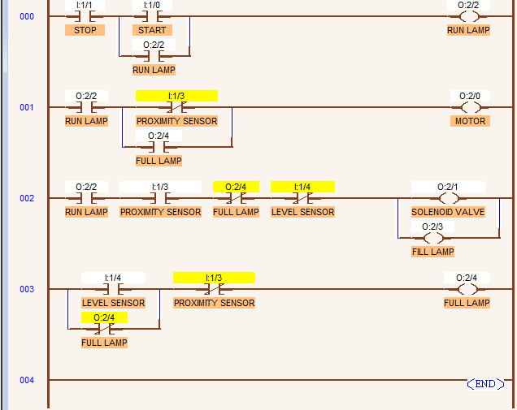
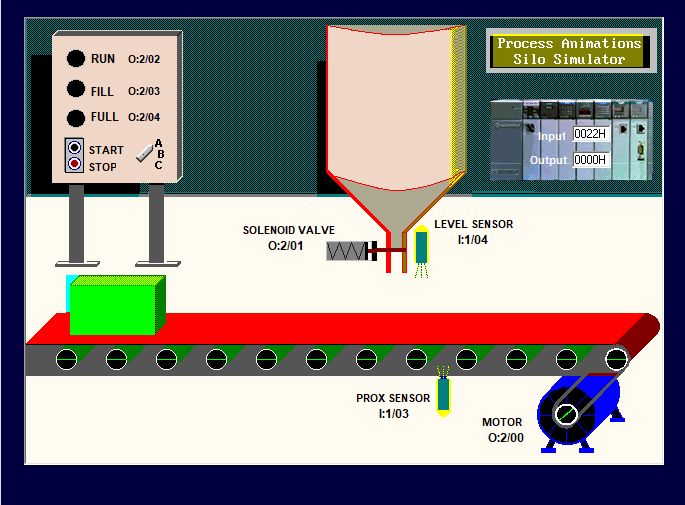

# PLC-Based Silo Filling System

## Project Overview
An automated silo filling system developed using PLC Ladder Logic and a silo simulation environment. The system controls a conveyor motor and solenoid valve using proximity and level sensors.

## Components
- PLC
- Conveyor Motor
- Proximity Sensor
- Level Sensor
- Solenoid Valve
- START and STOP Push Buttons
- RUN, FILL and FULL Indicator Lamps

## Working Principle
1. Press START to activate the system.
2. The conveyor motor starts moving objects.
3. The proximity sensor detects an object at the filling position.
4. The solenoid valve opens to fill the silo.
5. The level sensor detects when the silo is full.
6. The filling process stops and the FULL indicator activates.

## Ladder Logic

## Silo Simulation

## Software and Tools Used
- LadderLab (PLC Ladder Logic Programming and Simulation)
- Silo Process Simulator
